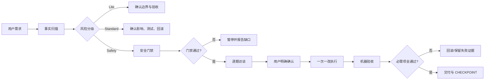
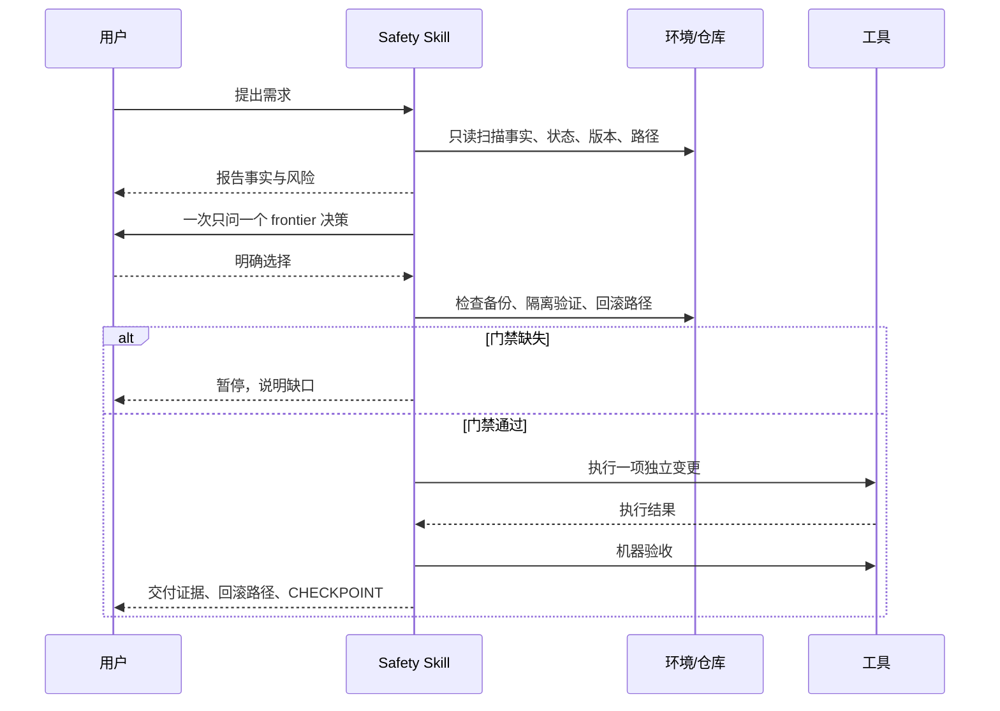

# DSH Grill-me Safety

> 面向 DSH 的安全变更决策与可验证交付协议。先把事实查清，再把风险问清，最后才执行有副作用的变更。
>
> **实现边界（v0.1）**：这是由 agent 遵循的协议、清单和模板，不是已经接管工具权限的强制执行器；“必须”表示协议要求，实际仍需由执行者完成并记录验收。

[](LICENSE)

## 这是什么

`grill-me-safety` 是一个供 DSH 使用的 Skill 协议，专门处理插件、profile、MCP、凭证和宿主环境等高风险变更。它把“多问几个问题”变成一条可审计的工程流程：



## 解决的问题

- **避免误操作**：先确认目标 profile、路径、范围和回滚方式。
- **避免环境污染**：检查 `@deepseek-ai/*` 宿主核心包是否被重复装入 profile。
- **避免伪安全感**：把事实、推断、未知和用户决策分开记录，不用 stars 或单一分数代替审查。
- **避免“命令成功即完成”**：执行后必须做 acceptance，必需项失败不能标记 done。
- **保留可恢复证据**：输出备份路径、回滚命令、证据链、CHECKPOINT 和复盘入口。

## 什么时候触发

### 显式触发

用户说下面这类话时进入逐题访谈：

- “拷问我这个方案” / “grill 我一下”
- “先别动手，把这事问清楚”
- “盘问一下这个需求”
- “帮我压力测试一下这个方案”

### 自动触发

以下动作默认进入 Safety Mode：

- 安装、升级、卸载 DSH 插件
- 修改 `package.json`、`cordis.patch.yml` 或 profile
- 操作 `~/.dsh`、重启宿主、接入 MCP
- 配置外部服务、认证、凭证或权限
- 可能破坏现有环境或难以回滚的文件/系统变更

### 不触发

纯事实查询、普通代码评审、低风险单文件编辑，以及正文中偶然提到 `grill-me`，不应误触发本协议。

## 核心流程



## 安全门禁速览

执行前必须满足：

1. 目标 profile、目标文件、绝对路径和变更范围明确。
2. 所有将被改写的配置已备份，并记录备份路径。
3. 可隔离验证时，先在独立 profile 或 dry-run 验证。
4. 一次只做一项独立变更，验收通过后再做下一项。
5. 检查宿主核心包、`engines`、安装脚本、权限和 profile `node_modules` 风险。
6. 新增 patch 条目使用 `- insert: [{ id, name, config }]` 语义。
7. 执行前写出可复制的 rollback 命令，并核对目标路径。
8. 用户明确确认后，才允许有副作用的工具调用。

任一项不满足，都应暂停，而不是用“用户说继续”绕过门禁。

## Plugin Preflight

安装、升级或卸载插件前，先生成结构化体检报告，至少记录：

- 来源、包名、版本、许可证、commit/release 与 immutable digest
- stars、forks、issues/discussions、近期提交和维护者回应（带采样时间）
- DSH/profile、Node、OS/arch、package manager 和 `engines` 兼容性
- 宿主核心包、安装脚本、权限、patch 和 profile `node_modules` 风险
- 维护活跃度、社区采用度、工程质量、DSH 风险四个独立维度

报告不是安装授权：先问是否隔离验证，隔离通过后再问是否安装到目标 profile。

## 目录

| 路径 | 用途 |
|---|---|
| `SKILL.md` | 完整协议：触发、事实扫描、访谈、门禁、验收和交付 |
| `references/safety-checklist.md` | 变更前、执行中、验收后的逐项清单 |
| `references/acceptance.md` | 通用机器验收协议与不同变更类型的验收矩阵 |
| `references/plugin-preflight.md` | 插件安装前体检、证据模型、阻断规则和状态机 |
| `templates/plugin-preflight-report.yaml` | 可复制的结构化体检报告模板 |
| `LICENSE` | MIT License |

## 安装 / 使用

将本目录复制到用户级 Skill 目录，或放入 DSH 能扫描到的项目根 `.dsh/skills/`：

```text
~/.dsh/skills/grill-me-safety/
```

安装后可用这些话触发：

```text
拷问我这个方案
先别动手，把这事问清楚
把这个插件装到 desktop profile
帮我改 cordis.patch.yml
接入一个 MCP 服务
```

## 当前边界与版本路线

当前是 **v0.1 协议版**：提供文档化流程、清单、报告模板和证据约束；不包含 Cordis 状态机、工具级阻断或跨会话持久化。后续可在协议验证稳定后实现 v0.2 插件版。

## 许可证

本项目使用 [MIT License](LICENSE)。
