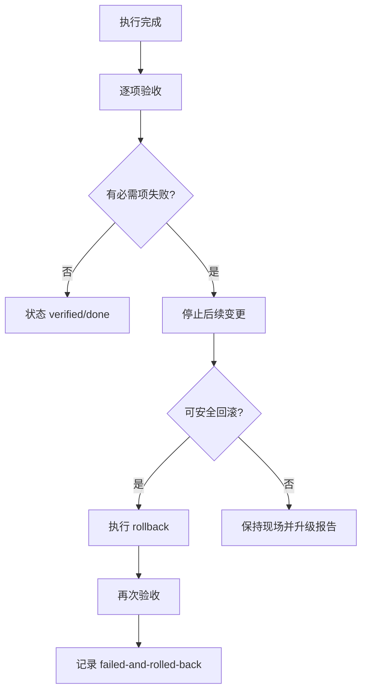

# Acceptance Protocol

> Acceptance 是机器验收，不是用户口头确认。命令成功只说明动作完成，不说明目标状态正确。

## 一、结果状态

| 结果 | 含义 |
|---|---|
| `passed` / 通过 | 已执行并满足预期，附 evidence |
| `failed` / 失败 | 已执行但不满足预期，记录原因、影响和下一步 |
| `not_run` / 未执行 | 有明确原因且记录批准的例外 |
| `blocked` / 阻断 | 因安全门禁、来源或环境问题禁止执行 |

`done` 只能在所有必需项为 `passed` 时使用。必需项为 `failed`、`not_run` 或 `blocked` 都不能完成；例外批准只能解释为什么未执行，不能把未执行改写成通过。失败不能用用户口头确认覆盖。

## 二、通用验收表

| 检查项 | Lite | Standard | Safety | 结果 | Evidence |
|---|---:|---:|---:|---|---|
| 目标文件/配置结构有效 | 必需 | 必需 | 必需 | ☐ 通过 ☐ 失败 ☐ 未执行 | |
| 新会话可以创建 | — | 视变更 | 必需 | ☐ 通过 ☐ 失败 ☐ 未执行 | |
| 没有重复安装宿主核心包 | — | 视变更 | 必需 | ☐ 通过 ☐ 失败 ☐ 未执行 | |
| 预期命令/工具/能力可见 | 视变更 | 必需 | 必需 | ☐ 通过 ☐ 失败 ☐ 未执行 | |
| 普通任务不误触发 | 视 skill 变更 | 视 skill 变更 | 必需 | ☐ 通过 ☐ 失败 ☐ 未执行 | |
| 回滚命令已验证 | — | 必需 | 必需 | ☐ 通过 ☐ 失败 ☐ 未执行 | |
| CHECKPOINT/交接证据已写入 | 视任务 | 必需 | 必需 | ☐ 通过 ☐ 失败 ☐ 未执行 | |

## 三、按变更类型验收

### 3.1 Skill / 文档变更

- [ ] YAML frontmatter 可解析，`name` 和 `description` 存在。
- [ ] 目录内引用的文件真实存在。
- [ ] Mermaid 图的节点和流程与正文一致。
- [ ] 普通任务示例不会触发 Safety Mode。
- [ ] 高风险任务示例能路由到门禁和验收流程。

### 3.2 插件安装或升级

1. 报告中的 `report_id` 与执行记录一致。
2. 扫描后、安装前再次核对 immutable artifact digest。
3. 实际安装包名和版本与报告一致。
4. 新会话创建成功。
5. profile 中没有重复宿主核心包。
6. 预期命令或工具出现并能工作。
7. 非目标任务不会误触发。
8. 回滚命令和备份路径已确认。

### 3.3 profile / patch 变更

1. patch 结构能被目标 profile 解析。
2. 新增项使用 `insert` 语义。
3. 独立 profile 验证通过后才触及 desktop。
4. 新会话创建成功。
5. 原有功能没有回归。
6. 回滚演练指向正确备份。

## 四、验收记录模板

```yaml
acceptance:
  - id: A1
    mandatory: true
    command_or_observation: ""
    expected: ""
    result: passed # passed | failed | not_run | blocked
    evidence_ids: []
    ran_at: ""
    executor: ""
    report_id: ""
    artifact_digest: ""
    notes: ""
```

## 五、失败处理



失败记录至少包含：失败项、实际值、预期值、影响范围、已采取动作、回滚路径、下一步负责人和时间。
