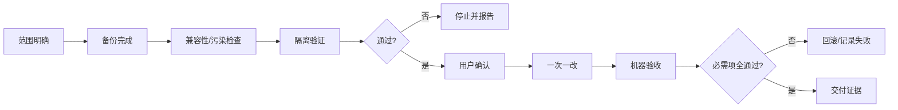

# Safety Gate Checklist

> 用于 DSH 插件、profile、MCP、凭证和宿主环境变更。任何不确定项都暂停并询问，不猜测。

## 一、变更前：范围与事实

- [ ] 需求属于 Lite / Standard / Safety 的哪一类已明确。
- [ ] 目标 profile 已明确；没有把 desktop 当作默认目标。
- [ ] 目标文件、绝对路径和变更范围已明确。
- [ ] 已检查 `~/.dsh/插件能力地图.md`，确认没有重复造已有能力。
- [ ] 当前 git status/diff 已只读检查。
- [ ] DSH 版本、Node、OS/arch 和 package manager 已记录（如适用）。
- [ ] 外部来源、包名、版本、commit/release 已锁定（如适用）。

## 二、变更前：备份与回滚

- [ ] 每个将改写的配置均已备份。
- [ ] 备份使用带时间戳的路径，并已记录校验或文件大小。
- [ ] 回滚命令已写出。
- [ ] 回滚命令的目标路径已逐字核对。
- [ ] 已明确回滚触发条件：验收失败、核心包重复、配置结构异常或新会话失败。

## 三、兼容性与宿主污染

- [ ] 目标包的 `engines` 与当前环境已比对。
- [ ] 已检查 Node/OS/arch、prerelease 和传递依赖。
- [ ] 已检查安装/生命周期脚本及其权限要求。
- [ ] 目标包未引入 `@deepseek-ai/*` 宿主核心包；若引入则暂停。
- [ ] profile `node_modules/@deepseek-ai/` 未出现重复核心包。
- [ ] 新增 patch 使用 `- insert: [{ id, name, config }]`。
- [ ] 没有通过 dshmarket 开关误改手写 patch。
- [ ] 已锁定 immutable artifact digest；浮动 tag/URL 不作为最终证据。

## 四、隔离验证

- [ ] 独立 profile 或 dry-run 路径已确定。
- [ ] 隔离验证在目标变更之前完成。
- [ ] 隔离结果、命令、时间和 artifact digest 已记录。
- [ ] 隔离验证失败时没有直接改 desktop。

## 五、执行纪律

- [ ] 用户已明确确认目标 profile 和执行动作。
- [ ] 本轮只执行一项独立变更。
- [ ] 每个写操作前已再次核对路径。
- [ ] 写操作结果已记录；发现异常立即停止。

## 六、机器验收

- [ ] 目标文件或配置结构有效。
- [ ] 新会话可以创建。
- [ ] 宿主核心包没有重复安装。
- [ ] 预期功能、命令或工具实际出现。
- [ ] 普通任务不会误触发 Safety 协议。
- [ ] 回滚命令已 dry-run 或演练，且指向正确备份。
- [ ] 结果已写入 CHECKPOINT.md 或等价交接记录。

## 七、强制暂停条件

出现任一情况，禁止继续：

- 目标路径或 profile 不明确。
- 没有备份却准备改 profile。
- 无法说明如何回滚。
- 发现宿主核心包重复安装。
- patch 使用未知 id 的裸条目。
- 来源、版本或 digest 无法确认。
- 隔离验证失败却准备直接改 desktop。
- 用户尚未明确确认有副作用的动作。
- 任一必需验收项失败。

